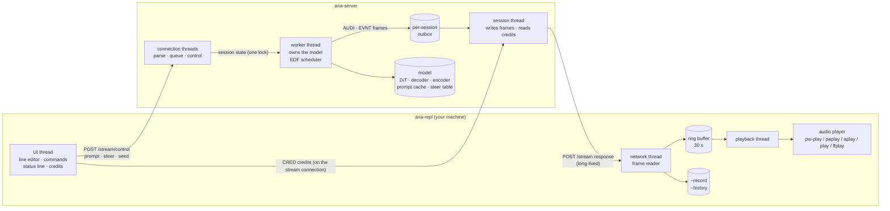
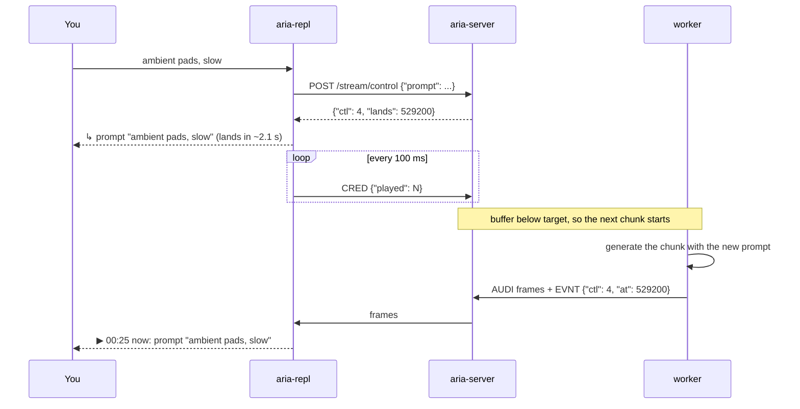
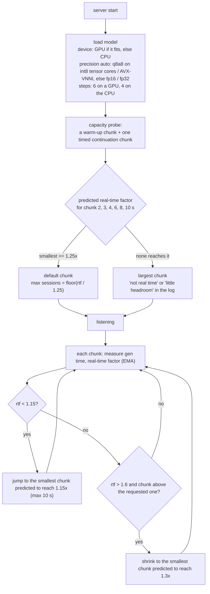

# Live mode: aria-server + aria-repl

aria can generate music without end and let you steer it while it plays. A resident
**server** (`aria-server`) holds the model and streams audio; a small terminal **client**
(`aria-repl`) plays it and sends your changes. You type a prompt, and a few seconds later
you hear it; you type another, or steer toward a taste, and the music follows.

This page explains how that works: how the stream is built, how buffering keeps it
seamless, how the system adapts to the machine it runs on, and the knobs you can turn.

- [Quick start](#quick-start)
- [Architecture](#architecture)
- [How a stream is built](#how-a-stream-is-built)
- [Streaming and buffering](#streaming-and-buffering)
- [Automatic adaptation](#automatic-adaptation)
- [The server: sessions, queue and caches](#the-server-sessions-queue-and-caches)
- [The REPL](#the-repl)
- [Protocol reference](#protocol-reference)
- [Measured performance](#measured-performance)
- [Limitations](#limitations)

## Quick start

```sh
make live                                              # builds aria-server and aria-repl
hf download matteospanio/aria --local-dir directions   # taste directions (optional)
scripts/aria-live.sh -m models/small-music --steer-dir directions/small
```

`aria-live.sh` starts the server, waits until it is ready, runs the REPL against it, and
stops the server when you quit. Everything after `--` goes to the REPL:

```sh
scripts/aria-live.sh -m models/small-music -- --record take.wav --history take.jsonl
```

To run the server on a machine with a GPU and the client on your laptop, tunnel the
port (the server listens on 127.0.0.1 only, and has no authentication):

```sh
ssh gpu-box 'aria-server -m models/small-music --steer-dir directions/small --log aria-server.log'
ssh -N -L 8321:127.0.0.1:8321 gpu-box &
./aria-repl --chunk 1 --buffer 1
```

## Architecture



Only the worker touches the model, so there is no locking on the hot path. The client never
loads a model: it only plays audio, which is why a laptop can drive a remote GPU.

## How a stream is built

Stable Audio 3 generates a whole clip at once, not sample by sample. A stream is therefore a
chain of **chunks**: each one regenerates a short window conditioned on the end of what came
before (the *context*), and only the new part is kept.

```
chunk 0 (text to audio), an 11 s window:
  |<------------ context + chunk: kept (8 s) ------------>|<---- tail: dropped (3 s) ---->|

every later chunk (continuation), a 12.5 s window:
  |<---- context: given (6 s) ---->|<- seam (1.5 s) ->|<- chunk: kept (2 s) ->|<- tail (3 s) ->|
   the end of what was already                          crossfaded onto the
   played, encoded back to latents                      stream (0.25 s)
```

- **Window.** Every continuation regenerates `context + seam + chunk + tail` seconds: 6 + 1.5
  + 2 + 3 = 12.5 s for the default 2 s chunk. The 1.5 s seam right after the context and the
  3 s tail (Stable Audio 3 ends clips with an outro) are thrown away; only the body is kept.
- **Context.** The last 6 s of output are encoded back to latents and given as the known part
  of the window. Only the kept frames are encoded (plus the encoder's receptive field), so this
  costs about half a full-window encode.
- **Stitching.** The new body is phase-aligned to the existing tail (a 40 ms cross-correlation
  over a 0-180 ms shift, so drum hits do not flam) and crossfaded over 0.25 s.
- **Cost.** A chunk costs about as much as generating its whole window, and the context/seam/
  tail overhead is fixed. Longer chunks are therefore cheaper per second of audio: on a laptop
  CPU, going from 6 s to 10 s chunks adds 67 % of audio for 22 % more work.

The session keeps only the tail of the stream it still needs, so it can run for hours in
constant memory.

Options that shape a stream: `--chunk` (seconds per chunk), `--context` (seconds of
context; 6 s measurably keeps the music more coherent than 4 s), `/seed`, `/evolve n` (a
fresh seed every n chunks, for variation) and `/anchor b` (pull each context back toward a
reference, so long streams do not fade out).

## Streaming and buffering

Each chunk goes to the client as soon as it is generated, in frames of at most 1 s; the
client buffers them and plays. Two rules keep this both seamless and responsive:

- **The server works ahead, but not too far.** It generates the next chunk only while less
  than the session's *buffer* is generated beyond what the client has played. The client
  reports what it played ("credits"); the server never relies on TCP backpressure, because
  socket buffers would silently hold ~30 s of audio and every change would land ~30 s late.
- **A change lands on the next chunk not yet started.** So the reaction time is roughly the
  buffer: about one chunk.



**Credits ride the stream connection.** The client sends a small `CRED` frame on the same
socket it receives audio on, every 100 ms: one one-way trip, no new connection. Through an
ssh tunnel with a 300 ms round trip this is what makes a 1 s buffer work.

**The buffer adapts.** `--buffer` sets the target (default: one chunk). A smaller buffer
means faster reactions and less slack for network or compute hiccups. After an underrun
the client plays silence, waits for 1 s of audio, and raises the buffer by 0.5 s (up to 6 s);
the next credit tells the server. Whatever you ask, the server always keeps at least a
chunk's generation time buffered, because a chunk is only heard once fully generated.

## Automatic adaptation

aria picks its settings for the hardware it finds, then keeps adjusting while it streams.



- **Device defaults.** On a GPU: 6 denoising steps; q8 weights with int8 activations
  (`q8a8`) on cards with int8 tensor cores (RTX 20-series and later), fp16 otherwise. On the
  CPU: 4 steps, and `q8a8` on CPUs with AVX-VNNI (Intel 12th gen and later, AMD Zen 4 and
  later), fp32 otherwise. Each of these passed an A/B quality check; `-s` and `--precision`
  override them.
- **Capacity probe.** One timed chunk predicts every chunk size, because a chunk's cost
  scales with its window. The probe sets the default chunk and how many live sessions the
  server accepts. `GET /info` reports it; `--no-probe` skips it.
- **Runtime chunk adaptation.** A laptop CPU boosts for a few tens of seconds and then
  throttles, so a startup measurement can be optimistic. The server keeps measuring each
  session and lengthens the chunk when it falls behind (the client shows `~ server chunk 4 →
  10 s`), or shortens it again, never below the chunk the client asked for, when there is
  headroom. Longer chunks mean later reactions, so the client says so.
- **Adaptive buffer.** See [Streaming and buffering](#streaming-and-buffering).

## The server: sessions, queue and caches

**Several clients at once.** The worker serves every live session and the `/generate`
requests with an earliest-deadline-first rule: the next chunk goes to the session whose
buffer runs out soonest (buffered audio minus its expected generation time). `/generate`
jobs run in the gaps, when every session has enough slack for them (their cost is learned
from measured chunks), or after waiting `--max-wait` seconds (default 10).

| flag | default | effect |
|---|---|---|
| `--max-sessions n` | from the probe | live sessions; one more gets `503` with `retry_after` |
| `--queue n` | 32 | queued `/generate` jobs; one more gets `503` |
| `--max-wait s` | 10 | longest a `/generate` job yields to live sessions |
| `--bind ip` | 127.0.0.1 | `0.0.0.0` exposes the server (no authentication) |
| `--log file` | stderr | the activity log |
| `--steer-dir dir` | none | load named steering directions (repeatable) |
| `--no-probe` | | 2 s chunks, 1 session |

**Prompt cache.** The text encoder turns a prompt into an embedding; the server keeps the
last 32 in a least-recently-used cache (about 0.8 MB each). Every chunk of a stream re-sends
its prompt, so all but the first hit the cache, and going back to a prompt from your history
costs nothing. The key is the exact prompt text (the REPL trims surrounding spaces);
text-conditioning steering works on a copy, so cached embeddings are never altered.

**Steering table.** `--steer-dir` loads every direction once at startup (the
[Hugging Face layout](https://huggingface.co/matteospanio/aria): `dirs_meta.json` gives each
taste's layer; a `_latent` or `_text` suffix selects those sites). Clients steer by name,
`/steer sweet 0.3`, and never send file paths. Changing a scale costs nothing extra.

**Activity log.** One timestamped line per event, tagged with the request or session id:

```
12:48:06.485 [s1] open (r2) "warm romantic piano, slow, tender" chunk=2.0 context=6.0 ahead=2.0 seed=7 steer=-
12:48:13.268 [s1] ctl#1 steer=sweet:0.30 lands@00:09.75
12:48:15.304 [s1] chunk 2 at=00:09.64 +1.92s gen=521ms rtf=3.8x ahead=3.38s prompt#1 seed=7 steer=sweet:0.30
12:48:27.333 [s1] close reason=stop audio=00:22.81 chunks=9
```

## The REPL

Type a prompt to start; type another at any time to change it.

| command | effect |
|---|---|
| *text* | start the stream, or change the prompt |
| `/steer name x` | steer toward a taste (`0` removes it); `/steer off` removes all |
| `/steers` | list the server's directions |
| `/seed n` · `/evolve n` · `/anchor b` | new seed · reseed every n chunks · re-anchor (0-1) |
| `/pause` · `/resume` | hold playback (the server waits) |
| `/stop` | end the stream (what is buffered still plays) |
| `/status` · `/help` · `/quit` | |

Each change is reported when sent, with an estimate of when you will hear it, and again
when it becomes audible. The status line shows the position, the buffer, the server's speed,
the audible steering and whether you are recording:

```
aria> /steer sweet 0.3
  ↳ 00:05 sweet 0.00 → 0.30  (lands in ~2.1 s)
  ▶ 00:07 now: sweet 0.00 → 0.30
[00:12 ▶ buf 2.3 s · 3.8× · sweet +0.30 · rec ●]
```

| flag | effect |
|---|---|
| `--host h:port` | server (default 127.0.0.1:8321) |
| `--record f.wav` | save everything received (float WAV, valid even if interrupted) |
| `--history f.jsonl` | one line per change: when it was sent (`t_sent`) and when it became audible (`t_audio`) |
| `--buffer s` | buffer target (default one chunk) |
| `--chunk s` · `--context s` · `--seed n` | session shape |
| `--player "cmd"` | play through a command (`{sr}` and `{ch}` are substituted; raw float on stdin) |
| `--out -` · `--no-play` | raw float on stdout instead of a player · no audio output |
| `--duration s` | stop after s seconds of audio (for scripts) |

Without a terminal the REPL reads commands line by line, so it can be scripted:

```sh
{ echo "warm piano"; sleep 10; echo "/steer sweet 0.3"; sleep 30; } | ./aria-repl --no-play --duration 30 --record take.wav
```

## Protocol reference

All JSON is flat (one level of keys). The live protocol is in
[`src/aria_live.h`](src/aria_live.h).

| endpoint | body | answer |
|---|---|---|
| `GET /health` | | `{"ok":true}` |
| `GET /info` | | model, sample rate, channels, probed `chunk`, `rtf`, `max_sessions` |
| `GET /steers` | | the named directions |
| `POST /generate` | `prompt`, `seconds`, `steps`, `seed`, `steer` | a float WAV |
| `POST /stream` | `prompt`, `seed`, `chunk`, `context`, `ahead`, `steps`, `anchor`, `evolve`, `steer` | a framed stream until the session ends |
| `POST /stream/control` | `session` + any of `prompt`, `steer`, `seed`, `evolve`, `anchor`, `played`, `stop` | `{"ok","ctl","lands","sent","played"}` |

`steer` is `"name:scale,name:scale"`; in a control it merges (`scale 0` removes one, `"off"`
clears all), and nothing is applied if any name is unknown.

A `/stream` body is a sequence of frames: a 4-byte tag, a little-endian u32 length, and the
payload.

| tag | direction | payload |
|---|---|---|
| `HELO` | server → client | JSON: session id, sample rate, channels, seed, chunk, context, buffer |
| `AUDI` | server → client | u64 first frame + interleaved float32 audio (≤ 1 s) |
| `EVNT` | server → client | JSON, one per chunk: `at` (first frame its controls are heard), `gen_ms`, `rtf`, `ahead_ms`, `ctl`, `steer`, `chunk_s` |
| `DONE` / `ERRO` | server → client | JSON: reason and frames / error |
| `CRED` | client → server | JSON: `played` frames, `ahead` seconds |

## Measured performance

small-music, default settings unless noted.

| setup | chunk / buffer | real time | reaction (change lag) | underruns |
|---|---|---|---|---|
| RTX 3070 server, client on the same machine | 2 s / 2 s | 3.8× | 2.2 s avg, 2.5 s max | 0 in 23 s |
| RTX 3070 server, laptop client over an ssh tunnel | 2 s / 2 s | 6.2× | 2.7 s avg, 3.2 s max | 0 in 62 s |
| same, tuned for latency (300 ms tunnel) | 1 s / 1 s | 2.2× | 1.2 s avg, 1.4 s max | 0 in 61 s |
| i5-1235U laptop, CPU only, quiet (throttled) mode | 10 s (picked by the probe) | ~1.05× | ~12 s | 0 in 164 s |

The first row predates the shorter continuation encode, which took the RTX 3070 from 3.8× to
about 6×. On the laptop the server runs the int8 (AVX-VNNI) kernel with 4 steps; a 6 s chunk
would be 0.81× real time there, which is why the probe picks 10 s.

## Limitations

- `aria-server` and `aria-repl` are POSIX-only for now; the Windows port is in progress.
- The medium model streams, but not in real time yet (its audio encoder runs on the CPU).
- The server has no authentication: keep it on 127.0.0.1 and use a tunnel.
- A stop or a change cannot interrupt a chunk already being generated.
